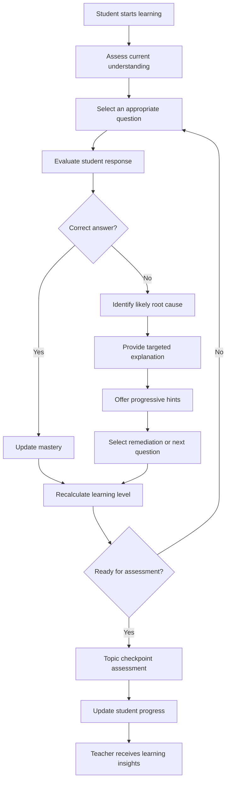
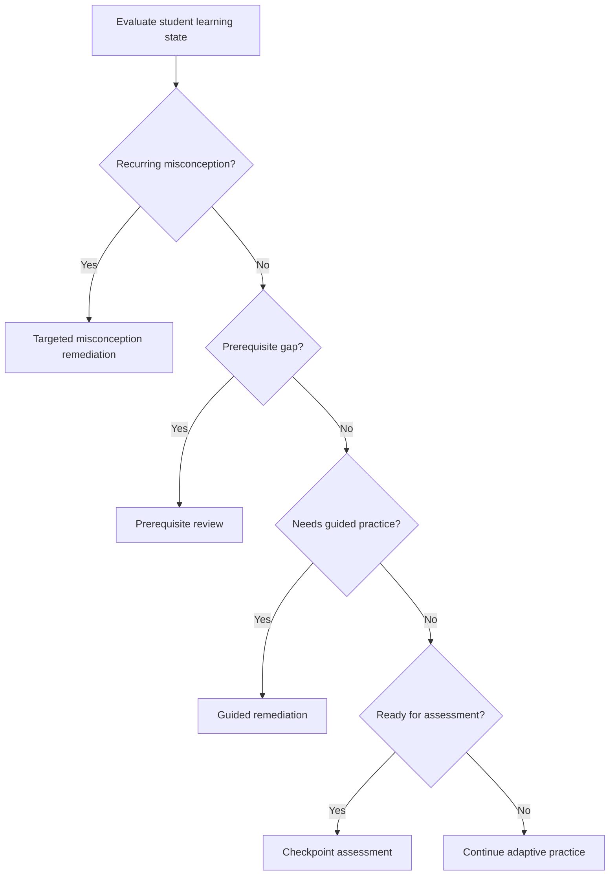
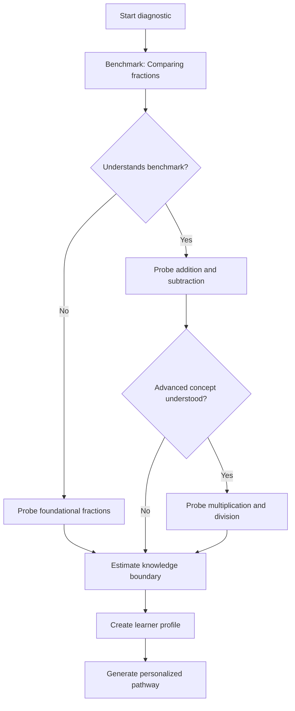
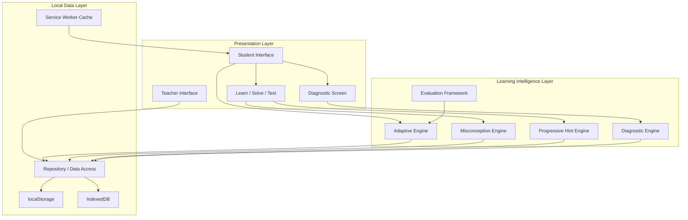

# GatiPath — Adaptive Learning That Moves at Every Student's Pace

<p align="center">
  <strong>Learn smarter. Practice better. Progress at your own pace.</strong>
</p>

<p align="center">
  An adaptive learning platform designed to help students understand concepts, identify learning gaps, and improve through personalized learning experiences.
</p>

<p align="center">
  <a href="https://pratikbisen.github.io/gatipath/"><strong>Live Demo</strong></a> ·
  <a href="https://github.com/PratikBisen/gatipath"><strong>GitHub Repository</strong></a>
</p>

---

## Table of Contents

1. [Overview](#-overview)
2. [The Problem](#-the-problem)
3. [Our Solution](#-our-solution)
4. [Core Philosophy](#-core-philosophy)
5. [Key Features](#-key-features)
6. [How Adaptive Learning Works](#-how-adaptive-learning-works)
7. [Root-Cause Identification](#-root-cause-identification)
8. [Smart Diagnostic Assessment](#-smart-diagnostic-assessment)
9. [Progressive Hint System](#-progressive-hint-system)
10. [Learn–Solve–Test Learning Cycle](#-learnsolve-test-learning-cycle)
11. [Teacher Dashboard](#-teacher-dashboard)
12. [Evaluation and Testing](#-evaluation-and-testing)
13. [Offline Capabilities](#-offline-capabilities)
14. [Language Accessibility](#-language-accessibility)
15. [Technology Stack](#-technology-stack)
16. [System Architecture](#-system-architecture)
17. [Project Structure](#-project-structure)
18. [Getting Started](#-getting-started)
19. [Demo Accounts](#-demo-accounts)
20. [Demonstration Walkthrough](#-demonstration-walkthrough)
21. [Testing](#-testing)
22. [Curriculum Scope](#-curriculum-scope)
23. [Data Privacy and Security](#-data-privacy-and-security)
24. [Current Limitations](#-current-limitations)
25. [Future Roadmap](#-future-roadmap)
26. [Contributing](#-contributing)
27. [Acknowledgements](#-acknowledgements)
28. [License](#-license)

---

## 📖 Overview

**GatiPath** is an adaptive learning platform developed for the Code Kernel '26 hackathon challenge: *Adaptive Learning for Classes 6 to 10*.

Traditional educational systems often follow a fixed learning sequence. Every student receives the same explanation, solves similar questions, and is evaluated using the same assessment.

But students do not learn at the same pace.

One student may understand a mathematical concept immediately but struggle with calculations. Another may repeatedly make mistakes because an earlier concept was never understood. A third student may already have mastered the topic and need more challenging questions.

GatiPath addresses this problem by adapting the learning experience according to each student's demonstrated understanding.

Instead of simply evaluating whether an answer is correct or incorrect, GatiPath attempts to understand **why the student made a mistake, what they should learn next, and how they can improve.**

It combines a deterministic adaptive learning engine, diagnostic assessment, misconception detection, progressive hints, personalized question selection, and teacher-oriented learning insights.

### Project Information

| Attribute | Details |
|---|---|
| Project | GatiPath |
| Category | Adaptive Learning / EdTech |
| Hackathon | Code Kernel '26 |
| Problem Statement | Adaptive Learning for Classes 6–10 |
| Pilot Subject | Mathematics |
| Pilot Class | Class 7 |
| Pilot Module | Fractions |
| Primary Users | Students and Teachers |
| Architecture | Modular frontend with deterministic learning engines |
| Deployment | GitHub Pages |
| Repository | PratikBisen/gatipath |

---

## 🎯 The Problem

A classroom contains students with different levels of understanding, learning speeds, and educational backgrounds.

However, traditional learning platforms often treat every student as if they have identical knowledge.

This creates several problems:

- **Unidentified knowledge gaps:** Students may progress to advanced topics without understanding prerequisite concepts.
- **Delayed feedback:** Teachers often discover learning gaps only after formal assessments.
- **Generic practice:** Students receive questions that may be too easy or too difficult.
- **Answer-focused learning:** Many platforms tell students whether an answer is correct without identifying the underlying misunderstanding.
- **Limited teacher visibility:** Teachers may not immediately know which concepts are difficult for the class.
- **Unequal learning opportunities:** Language and connectivity limitations can make digital learning less accessible.

The important question is not simply:

> Did the student answer correctly?

It is:

> What does this answer tell us about the student's understanding, and what should happen next?

GatiPath is designed around that question.

---

## 💡 Our Solution

GatiPath creates a personalized learning pathway using evidence collected from student interactions.

The platform continuously evaluates:

- Previous attempts.
- Correct and incorrect answers.
- Hint usage.
- Topic mastery.
- Prerequisite understanding.
- Recurring misconceptions.
- Recent learning performance.

Based on this information, it adjusts the next learning activity.

### The GatiPath Learning Loop



The learning pathway is not a fixed sequence. It responds to the student's demonstrated understanding.

---

## 🧠 Core Philosophy

GatiPath follows four principles.

### 1. Understand before advancing

A student should not be pushed forward simply because they completed a lesson. The system should consider their actual understanding.

### 2. Diagnose instead of merely evaluating

An incorrect answer should provide useful information about the student's thinking.

### 3. Guide instead of revealing

Students should receive meaningful hints and explanations that help them solve problems independently.

### 4. Empower teachers

Technology should help teachers make better instructional decisions, not replace them.

---

## ✨ Key Features

### For Students

| Feature | Description |
|---|---|
| Personalized dashboard | Shows progress, learning activities, and recommendations. |
| Smart diagnostic assessment | Estimates the student's current knowledge level. |
| Adaptive learning path | Organizes topics according to prerequisite relationships. |
| Concept-based learning | Provides explanations, examples, and visual representations. |
| Adaptive practice | Selects questions based on recent performance. |
| Root-cause feedback | Explains the likely reason behind incorrect answers. |
| Progressive hints | Provides assistance in multiple stages. |
| Mastery tracking | Updates topic progress based on demonstrated understanding. |
| Checkpoint assessments | Evaluates independent understanding. |
| Multilingual interface | Supports English, Hindi, and Marathi. |
| Offline support | Supports local learning data persistence and offline application capabilities. |
| Learning milestones | Encourages consistent learning without competitive pressure. |

### For Teachers

| Feature | Description |
|---|---|
| Teacher dashboard | Provides a summary of classroom learning activity. |
| Student roster | Organizes students and identifies support requirements. |
| Student dossiers | Shows individual learning history and progress. |
| Misconception analytics | Highlights frequently occurring learning difficulties. |
| Topic difficulty insights | Identifies topics requiring additional attention. |
| Intervention management | Supports remedial tasks, individual guidance, and peer support. |
| Improvement tracking | Highlights students demonstrating measurable progress in recorded attempts. |

---

## ⚙️ How Adaptive Learning Works

GatiPath does not rely on a general-purpose AI chatbot to decide whether students understand a concept.

Instead, its core learning logic uses deterministic algorithms and explicit educational rules.

This makes recommendations explainable, repeatable, and testable.

### 1. Mastery Estimation

The platform uses an Exponential Moving Average (EMA) to update the student's mastery estimate.

The reported implementation uses:

\[
M_{new}=0.7M_{old}+0.3S
\]

Where:

- \(M_{old}\) = Previous mastery score.
- \(S\) = Credit earned for the current response.
- \(M_{new}\) = Updated mastery score.

The scoring system considers how independently the student answered.

The reported scoring configuration is:

| Response behavior | Score credit |
|---|---:|
| Correct independently | 100 |
| Correct after hints | Depends on hint stage |
| Incorrect | 0 |

The progressive hint engine uses proportional credit to distinguish independent understanding from scaffolded performance.

Mastery is not determined by a single correct answer. The implementation also considers independent attempts and formal assessment performance.

### 2. Adaptive Difficulty

Question difficulty is adjusted using recent performance.

The engine considers a rolling window of recent attempts and uses it to determine an appropriate target difficulty.

The purpose is to avoid:

- Giving unnecessarily easy questions to students who have mastered a concept.
- Giving overly difficult questions to students who are still developing prerequisite understanding.
- Advancing students without sufficient evidence.

### 3. Recommendation Priority

The adaptive recommendation engine follows a priority-based decision structure.



The engine prioritizes:

1. Misconception remediation.
2. Prerequisite gap correction.
3. Guided remediation.
4. Assessment readiness.

The objective is to recommend the most useful next learning activity rather than simply moving students through a fixed curriculum.

---

## 🔍 Root-Cause Identification

One of GatiPath's central capabilities is distinguishing between different reasons for an incorrect answer.

A wrong answer does not always mean the student lacks conceptual understanding.

The system uses a three-tier classification approach.

| Root cause | Meaning | Example |
|---|---|---|
| Conceptual misunderstanding | Student has misunderstood the underlying mathematical concept. | Adding both numerators and denominators. |
| Prerequisite gap | Student lacks an earlier concept required to solve the current question. | Not understanding equivalent fractions before comparing fractions. |
| Calculation slip | Student understands the method but makes an arithmetic error. | Correct setup with an incorrect multiplication result. |

### Example: Denominator Addition Error

Consider the question:

\[
\frac{1}{4}+\frac{1}{4}
\]

A student answers:

\[
\frac{2}{8}
\]

The answer is incorrect because the student has added both numerators and denominators.

The correct calculation is:

\[
\frac{1}{4}+\frac{1}{4}=\frac{2}{4}=\frac{1}{2}
\]

GatiPath identifies the likely denominator-addition misconception and provides a visual explanation.

Instead of simply displaying the correct answer, it helps the student understand why the original approach was incorrect.

### Evidence-based classification

The system uses multiple pieces of evidence before confirming a recurring misconception.

An ambiguous incorrect answer should not automatically become a permanent misconception label.

The distinction between suspected and confirmed errors helps reduce misleading recommendations.

---

## 🧪 Smart Diagnostic Assessment

Students should not have to complete a long test just to establish what they already know.

GatiPath uses an adaptive placement assessment to estimate a student's knowledge boundary.

### How it works

1. The diagnostic begins with a benchmark question.
2. The system evaluates the response.
3. It selects an easier or more advanced question based on the result.
4. It continues until sufficient evidence is available.
5. It creates a knowledge profile for subsequent recommendations.

The current implementation reports a diagnostic range of approximately 2–5 questions, depending on the student's responses.

### Diagnostic branching



The purpose is efficient placement, not examination.

---

## 💬 Progressive Hint System

GatiPath encourages students to think through problems instead of immediately showing the solution.

The progressive hint engine provides four stages of assistance.

| Stage | Type | Purpose |
|---|---|---|
| 1 | Conceptual Reminder | Reminds students of the relevant concept. |
| 2 | Guided Next Step | Helps identify the next operation. |
| 3 | Specific Explanation | Provides more direct guidance. |
| 4 | Full Worked Solution | Demonstrates the complete solution. |

### Example

Question:

\[
\frac{1}{4}+\frac{1}{4}=?
\]

**Stage 1 — Conceptual Reminder**

Remember that fractions with the same denominator represent parts of equal-sized wholes.

**Stage 2 — Guided Next Step**

When the denominators are equal, what should you do with the numerators?

**Stage 3 — Specific Explanation**

Add 1 and 1. Keep the denominator 4 unchanged.

**Stage 4 — Worked Solution**

\[
\frac{1+1}{4}=\frac{2}{4}=\frac{1}{2}
\]

The scoring model distinguishes independent solving from solving with assistance.

---

## 📚 Learn–Solve–Test Learning Cycle

GatiPath structures learning into three connected stages.

### Learn

Students understand the concept through:

- Simple explanations.
- Visual mathematical models.
- Worked examples.
- Common mistake explanations.
- Conceptual illustrations.

### Solve

Students practice using:

- Adaptive questions.
- Immediate feedback.
- Progressive hints.
- Root-cause identification.
- Personalized recommendations.

### Test

Students demonstrate independent understanding through:

- Checkpoint assessments.
- Questions without hints.
- Topic-level evaluation.
- Mastery updates.
- Learning progression decisions.

The three stages work together. A student who struggles during practice should receive additional support before being expected to demonstrate independent mastery.

---

## 👩‍🏫 Teacher Dashboard

GatiPath is designed to support teachers with actionable information.

The teacher dashboard provides visibility into both individual and classroom-level learning patterns.

### Classroom insights

Teachers can inspect:

- Topics with the greatest difficulty.
- Frequently occurring misconceptions.
- Students who require additional support.
- Students progressing ahead of the class.
- Recorded improvements in student performance.

### Student dossiers

Each student profile can include:

- Topic-level mastery.
- Attempt history.
- Incorrect responses.
- Identified misconceptions.
- Hint usage.
- Assigned interventions.

### Intervention management

Teachers can record or assign:

- Remedial learning tasks.
- One-to-one guidance.
- Peer buddy support.
- Teacher notes.
- Pending and completed interventions.

The intention is to turn learning analytics into meaningful classroom action.

---

## 📊 Evaluation and Testing

A learning engine should not simply claim that it is adaptive. Its behavior should be testable.

GatiPath includes an evaluation framework that uses synthetic student archetypes to test its decision-making logic.

### Synthetic student archetypes

| Student profile | Simulated behavior | Expected engine response |
|---|---|---|
| Foundation Gap | Lacks equivalent fractions and LCM understanding. | Recommend prerequisite review. |
| Conceptual Trap | Adds denominators while adding fractions. | Identify conceptual misunderstanding. |
| Calculation Slip | Uses the correct method but makes an arithmetic error. | Avoid falsely diagnosing a conceptual misconception. |
| Accelerated Master | Consistently solves questions independently. | Progress toward assessment readiness. |
| Scaffolded Learner | Improves through progressive hints. | Recognize supported learning progress. |

### Reported automated test results

The Round 2 implementation report records:

| Metric | Reported result |
|---|---:|
| Automated Vitest tests | 22 |
| Passing tests | 22 |
| Passing test suites | 2 |
| Simulated student archetypes | 5 |
| Reported precision on the synthetic benchmark | 100% |
| Reported recall on the synthetic benchmark | 100% |

**Important:** These figures describe the reported automated and synthetic evaluation environment. They are not real-world diagnostic accuracy measurements and do not establish classroom learning gains.

Actual student trials and longitudinal educational validation remain future work.

---

## 🌐 Offline Capabilities

GatiPath includes offline-oriented functionality.

The reported implementation includes:

- Service worker asset precaching.
- Local persistence through browser storage.
- Offline attempt buffering.
- Network connectivity indicators.
- Reconnection handling.
- Idempotency support for attempt processing.

The exact synchronization behavior depends on the configured persistence backend.

The current project does not claim a fully operational shared cloud synchronization service across multiple devices or schools.

Offline capability should be evaluated by testing the application after initial loading, submitting attempts without connectivity, and checking persistence after reconnection.

---

## 🌍 Language Accessibility

The current interface supports three languages:

- English.
- Hindi.
- Marathi.

A centralized localization structure is used to manage translated interface content.

The intention is to make learning more accessible to students who are more comfortable studying in regional Indian languages.

Mathematical terminology requires particular care because an incorrect translation can create additional conceptual confusion.

The existing pilot's language coverage should not be interpreted as complete translation of every possible future curriculum module.

---

## 🛠 Technology Stack

| Technology | Purpose |
|---|---|
| React 19 | Frontend application |
| TypeScript 5.9 | Type-safe development |
| Vite 8 | Development server and production build |
| React Router v7 | Application navigation |
| Tailwind CSS v4 | Styling and responsive layouts |
| Lucide React | Interface icons |
| Canvas Confetti | Learning milestone feedback |
| Vitest 4 | Automated testing |
| localStorage | Local application state persistence |
| IndexedDB | Structured local data persistence |
| Service Worker | Offline asset caching |

### Architectural approach

GatiPath separates its learning logic into modular components:

- Adaptive engine.
- Diagnostic engine.
- Misconception engine.
- Progressive hint engine.
- Evaluation framework.
- Persistence and synchronization layer.
- Student interface.
- Teacher interface.

This separation makes the core learning logic easier to test and maintain independently from the user interface.

---

## 🏗 System Architecture

The following diagram represents the logical architecture of the current pilot.



The current deployment is a client-side pilot. A production multi-school architecture would require a server-side API, secure authentication, centralized database, authorization policies, and a robust synchronization service.

---

## 📁 Project Structure

The project is organized around a modular React application.

A simplified logical structure:

```text
gatipath/
│
├── public/
│   ├── sw.js
│   └── assets/
│
├── src/
│   ├── components/
│   │   ├── student/
│   │   ├── teacher/
│   │   ├── shared/
│   │   └── layout/
│   │
│   ├── pages/
│   │   ├── student/
│   │   ├── teacher/
│   │   └── diagnostic/
│   │
│   ├── engines/
│   │   ├── adaptive/
│   │   ├── diagnostic/
│   │   ├── misconceptions/
│   │   ├── hints/
│   │   └── evaluation/
│   │
│   ├── data/
│   │   └── curriculum/
│   │
│   ├── contexts/
│   ├── hooks/
│   ├── services/
│   ├── types/
│   ├── utils/
│   └── main.tsx
│
├── supabase/
│   ├── migrations/
│   └── seed.sql
│
├── PROJECT_CONTEXT.md
├── PRODUCT_REQUIREMENTS.md
├── DESIGN_SYSTEM.md
├── TECHNICAL_ARCHITECTURE.md
├── DATABASE_SCHEMA.md
├── IMPLEMENTATION_PLAN.md
├── TESTING_CHECKLIST.md
├── DEPLOYMENT.md
│
├── package.json
├── tsconfig.json
└── vite.config.ts
```

This is a conceptual overview. Refer to the actual repository for the authoritative directory and filename structure.

---

## 🚀 Getting Started

### Prerequisites

Install the following:

- Node.js 20 or later, compatible with the installed Vite version.
- npm.
- Git.

### 1. Clone the repository

```bash
git clone https://github.com/PratikBisen/gatipath.git
```

### 2. Enter the project directory

```bash
cd gatipath
```

### 3. Install dependencies

```bash
npm install
```

### 4. Start the development server

```bash
npm run dev
```

Open the local URL displayed in your terminal, usually:

```text
http://localhost:5173
```

### 5. Create a production build

```bash
npm run build
```

### 6. Run automated tests

```bash
npm run test
```

If the repository defines a different test script, inspect `package.json` and use the configured command.

---

## 🔑 Demo Accounts

The current demonstration environment provides separate student and teacher personas.

| Role | Email | Password |
|---|---|---|
| Student | student@gatipath.demo | demo1234 |
| Teacher | teacher@gatipath.demo | demo1234 |

These are demonstration credentials, not production authentication accounts.

The application also provides a persona switcher for moving between the student and teacher demonstration contexts.

---

## 🎬 Demonstration Walkthrough

The following scenario demonstrates the central value of GatiPath.

### Scenario: A student misunderstands fraction addition

**Step 1 — Student login**

Open the live application and select the student persona.

**Step 2 — Diagnostic assessment**

Start the Smart Knowledge Placement Diagnostic.

Observe how the system selects follow-up questions based on previous answers.

**Step 3 — Start learning**

Navigate to Class 7 Mathematics and the Addition and Subtraction of Fractions module.

**Step 4 — Encounter a misconception**

Present the question:

\[
\frac{1}{4}+\frac{1}{4}=?
\]

Select:

\[
\frac{2}{8}
\]

**Step 5 — Root-cause detection**

Observe the system identifying the denominator-addition error as a conceptual misunderstanding.

**Step 6 — Visual explanation**

The application displays a visual comparison explaining why the correct result is:

\[
\frac{2}{4}=\frac{1}{2}
\]

**Step 7 — Progressive guidance**

Move through the available hint stages and observe how the system provides increasingly specific assistance.

**Step 8 — Adaptive question selection**

Answer subsequent questions and observe how recent performance influences the next question.

**Step 9 — Mastery update**

Submit answers and inspect the change in topic mastery.

**Step 10 — Checkpoint assessment**

Complete the topic assessment without hints.

**Step 11 — Teacher dashboard**

Switch to the teacher persona.

**Step 12 — Teacher intervention**

Open the student's dossier and inspect:

- Previous attempts.
- Identified misconception.
- Learning progress.
- Hint usage.
- Suggested or recorded intervention.

This scenario demonstrates the complete journey from a student's misunderstanding to a teacher's actionable insight.

### Resetting the demo

Use the Reset control in the application header and confirm the reset operation to restore the demonstration data.

---

## 🧪 Testing

The project uses Vitest for automated testing.

The reported Round 2 baseline contains 22 passing tests across two suites.

The tested areas include:

- Mastery calculations.
- Misconception detection.
- Adaptive recommendation logic.
- Synthetic student simulations.
- Diagnostic branching.
- Progressive hint scoring.
- Idempotent attempt handling.

Run the test suite before submitting changes.

```bash
npm run test
```

Also verify the production build:

```bash
npm run build
```

Automated tests are necessary but not sufficient. Important student and teacher workflows should also be tested manually in a real browser.

---

## 📘 Curriculum Scope

The current pilot focuses on:

**Class 7 — Mathematics — Fractions**

| Module | Learning area |
|---|---|
| M701 | Representation and equivalence |
| M702 | Comparison and LCM |
| M703 | Addition and subtraction |
| M704 | Multiplication and division |

The module uses prerequisite relationships to organize the learning sequence.

The current pilot is not a complete Class 6–10 curriculum platform.

Curriculum alignment should be checked against the relevant NCERT textbook edition and official learning outcomes before claiming comprehensive coverage.

---

## 🔐 Data Privacy and Security

GatiPath is designed with student data responsibility in mind.

The current pilot includes demonstration authentication, role-based interface guards, and local browser persistence.

However, these mechanisms do not constitute production-grade security.

Before deployment in real schools, the platform requires:

- Server-side authentication.
- Secure session management.
- Server-enforced role-based authorization.
- Database-level access policies.
- Secure synchronization.
- Appropriate data retention and deletion procedures.
- A formal privacy and security review.
- Applicable child-data compliance assessment.

Do not use real children's personal or educational information in the public demonstration environment.

---

## ⚠️ Current Limitations

GatiPath is a functional hackathon pilot, not a fully deployed institutional learning management system.

The following limitations are acknowledged:

| Area | Current status |
|---|---|
| Curriculum | Focused on Class 7 fractions |
| Student validation | Synthetic scenarios; classroom trials remain necessary |
| Cloud database | Production cloud synchronization is not established |
| Authentication | Demonstration environment; production authentication required |
| Security | Server-side authorization and database security remain necessary |
| Offline functionality | Local offline capabilities; cross-device synchronization is not established |
| Language coverage | English, Hindi, and Marathi interface support in the current pilot |
| Audio accessibility | Further speech and screen-reader support is needed |
| Scalability | Multi-school deployment architecture remains future work |

The project intentionally prioritizes a demonstrable adaptive learning engine over superficial claims of complete platform readiness.

---

## 🗺 Future Roadmap

### Phase 1 — Adaptive Learning Pilot

- [x] Student learning interface.
- [x] Teacher dashboard.
- [x] Learn–Solve–Test workflow.
- [x] Rule-based adaptive recommendations.
- [x] Mastery estimation.
- [x] Root-cause classification.
- [x] Progressive hints.
- [x] Diagnostic branching.
- [x] Synthetic evaluation framework.
- [x] English, Hindi, and Marathi interface support.

### Phase 2 — Reliability and Validation

- [ ] Expanded automated and edge-case testing.
- [ ] Offline behavior validation across browsers.
- [ ] Real classroom pilot.
- [ ] Longitudinal learning outcome evaluation.
- [ ] Improved accessibility.
- [ ] Curriculum mapping verification.

### Phase 3 — Institutional Infrastructure

- [ ] Secure server-side authentication.
- [ ] PostgreSQL-backed centralized persistence.
- [ ] Server-side authorization and row-level access controls.
- [ ] Reliable multi-device synchronization.
- [ ] School, class, teacher, and student management.
- [ ] Administrative dashboard.

### Phase 4 — Curriculum Expansion

- [ ] Additional Class 6–10 mathematics modules.
- [ ] Algebra and geometry.
- [ ] More curriculum boards.
- [ ] Expanded regional language content.
- [ ] Teacher-managed learning content.

### Phase 5 — Advanced Personalization

- [ ] Spaced revision.
- [ ] Long-term knowledge retention tracking.
- [ ] Improved student knowledge estimation.
- [ ] More detailed learning analytics.
- [ ] Evidence-based personalization improvements.

---

## 🤝 Contributing

Contributions, suggestions, and educational feedback are welcome.

If you would like to contribute:

1. Fork the repository.
2. Create a feature branch.
3. Make focused changes.
4. Add tests for new adaptive learning behavior.
5. Run the existing test suite.
6. Verify the production build.
7. Submit a pull request describing your changes.

Example:

```bash
git checkout -b feature/your-feature
git add .
git commit -m "feat: describe your change"
git push origin feature/your-feature
```

Changes to adaptive learning logic should include tests demonstrating why the system makes a particular recommendation.

---

## 🙌 Acknowledgements

Developed for **Code Kernel '26** under the problem statement:

*Adaptive Learning for Classes 6 to 10.*

With support from the hackathon's supporting partner, **MyStartupWave**.

This project explores how explainable adaptive learning systems can help students learn at their own pace while giving teachers better visibility into individual and classroom-level learning needs.

---

## 📄 License

A license has not yet been specified for this repository.

Until a license is added to the repository, reuse and redistribution should not be assumed to be permitted.

---

<p align="center">
  <strong>GatiPath</strong>
  <br/>
  Learning should follow the student, not the other way around.
  <br/><br/>
  <a href="https://pratikbisen.github.io/gatipath/">Explore the Live Demo</a>
  ·
  <a href="https://github.com/PratikBisen/gatipath">Explore the Source Code</a>
</p>
